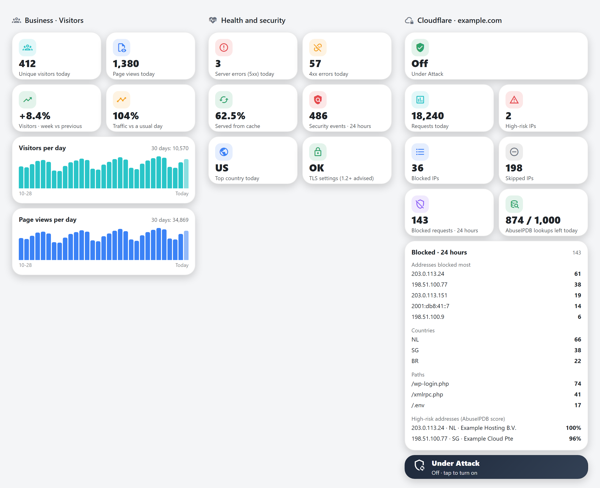

# Cloudflare Abuse Monitor

[](https://hacs.xyz)

A Home Assistant custom integration that monitors the visitors of one or more **Cloudflare** zones, checks each new IP address on **AbuseIPDB**, and can block high-risk addresses in the Cloudflare firewall. It can also enable Cloudflare **Under Attack Mode** automatically on a traffic spike, or manually with a switch.

The integration can be installed through [HACS](https://hacs.xyz) as a custom repository, or copied manually.

To support the project, you can [buy the author a coffee](https://coff.ee/niruse).

<picture>
  <source media="(prefers-color-scheme: dark)" srcset="docs/images/dashboard-dark.png">
  
</picture>

*The [example dashboard](#example-dashboard) with sample data.*

---

## Overview

At every update (every minute by default) the integration performs the following steps for each monitored zone:

1. It reads the traffic of the current day (requests, page views, bytes) from the Cloudflare GraphQL analytics.
2. It reads the IP addresses that matched the **Skip rule** today. These are the visitors of the zone (see [The firewall rules](#the-firewall-rules) for the reason a Skip rule is required).
3. It reads the IP addresses already in the Cloudflare IP list (`block_ips`).
4. It checks every visitor that is not yet in the list on AbuseIPDB, once, and again after a configurable number of days if rechecking is enabled. Scores are cached, so each IP address costs one AbuseIPDB lookup rather than one per update.
5. It classifies IP addresses whose score reaches the configured threshold as **high risk**. In **Active** mode it adds them to the IP list, and the Cloudflare Block rule blocks them. In **Monitor** mode it only reports them.
6. In **Active** mode, with automatic Under Attack Mode enabled, it enables Under Attack Mode when the number of requests between two updates reaches the configured threshold.
7. Every 15 minutes it also reads the zone's insights: visitors, page views, errors, cache, countries, security events and blocked requests for today and the last 30 days, and the zone's TLS settings (see [Insights](#insights)).
8. When a lookup finds a high-risk IP address, it fires an event that an automation can use to send a notification (see [Events](#events)).

All access uses one scoped Cloudflare API token, which can access only the selected zones and the IP lists of their accounts.

---

## Requirements

- **One or more Cloudflare zones**: domains on a [Cloudflare](https://dash.cloudflare.com/) account. The Free plan is sufficient: it allows five custom rules per zone and one IP list per account, and the integration requires two rules per zone and one list per account. If a zone already uses all five rules, the integration can make room with your approval (see [When the zone has no room for the rules](#when-the-zone-has-no-room-for-the-rules)).
- **An AbuseIPDB API key**: register at [AbuseIPDB](https://www.abuseipdb.com/) and create a key under **Account > API**. The free plan allows 1,000 lookups per day.
- Home Assistant 2025.12 or later.

---

## Installation

### HACS

1. Open **HACS**, then select the three-dots menu > **Custom repositories**.
2. Add `https://github.com/niruse/cloudflare_abuse_monitor` with the type **Integration**.
3. Install **Cloudflare Abuse Monitor** and restart Home Assistant.

### Manual installation

1. Copy the `custom_components/cloudflare_abuse_monitor` folder into `/config/custom_components/`.
2. Restart Home Assistant.

---

## Setup

1. Go to **Settings > Devices & services > + Add integration** and search for **Cloudflare Abuse Monitor**.
2. Select **Create a Cloudflare API token** in the form. The link opens the Cloudflare "Create account API token" page (select your account if prompted), with the token name and all five permissions prefilled.
3. **Verify that the following five permissions are listed.** If one is missing, add it with **+ Add more**.

   | Permission | Purpose |
   |---|---|
   | Zone > Zone > Read | Lists the zones and the account each zone belongs to. |
   | Zone > Analytics > Read | Reads the traffic summary and the visitors recorded by the Skip rule (GraphQL `httpRequests1hGroups` and `firewallEventsAdaptive`). |
   | Zone > Zone Settings > Edit | Reads and changes the security level of a zone, which is how Under Attack Mode is enabled and disabled. |
   | Zone > Zone WAF > Edit | Reads the custom firewall rules, and creates the Block and Skip rules during setup if they are missing. **Read** is sufficient if you create both rules yourself. |
   | Account > Account Filter Lists > Edit | Reads the IP list, adds and removes IP addresses, and creates the `block_ips` list during setup. |

   No other permission is required: no DNS, account settings or billing access.

4. **Restrict the token (required).** The link preselects *all accounts* and *all zones*, because the Cloudflare link format requires a value. Under **Account Resources**, select your account. Under **Zone Resources**, select the zones to be monitored: **Specific zone** for each zone, or **All zones from an account**. The token then has no access to anything else.
5. Create the token, copy it, and enter it in the form together with your AbuseIPDB API key.
6. **Select the zones.** If the token can access more than one zone that is not yet monitored, a list with a checkbox for each zone is shown. All zones are selected by default; deselect any zone that should not be monitored. If the zones belong to different accounts, each entry shows the account name. If the token can access exactly one such zone, this step is skipped.

The integration then completes the setup automatically:

- It verifies the token with Cloudflare (`/user/tokens/verify`, or the account endpoint for an account-owned token, once per account) and rejects a disabled or expired token.
- It lists every zone the token can access. Zones that another entry of this integration already monitors are not offered again.
- It verifies the AbuseIPDB key with a single lookup. If the daily quota is already used up, the key is accepted and a warning is written to the log.
- For each selected zone, it tests every permission without changing anything: one analytics row is read, the security level is written back unchanged, the IP lists are read, and the custom rules are read. Every missing permission is reported in the form, together with the zone concerned, and nothing is created for that zone until all checks pass.
- For each account, it uses the IP list `block_ips` if it exists (the Edit permission is verified by writing the description of the list back unchanged), or creates it. All selected zones of the same account share this one list; zones of a different account use that account's own list. If the list limit of the plan is reached, an existing IP list can be selected instead.
- For each zone, it creates the Block and Skip rules if they are missing. Existing rules are never replaced or duplicated.
- It starts in **Monitor** mode with the following defaults, which can be changed under **Configure**: score threshold 100, rechecking enabled after 7 days, an update every minute, and automatic Under Attack Mode disabled.

The token and the AbuseIPDB key are stored only in Home Assistant. They are never written to the log, and diagnostics downloads redact them together with the zone, account and list identifiers.

### Several zones

- One configuration entry corresponds to one Cloudflare API token. It can monitor any number of zones, in one or more Cloudflare accounts.
- Each zone is a separate device (for example **Cloudflare example.com**) with its own five sensors and its own Under Attack Mode switch.
- The IP list belongs to the Cloudflare account: zones of the same account block with the same list, so an address blocked for one zone is blocked for all zones of that account.
- The zones of an entry are updated one after another, one second apart, so that a token with many zones never sends a burst of requests to Cloudflare (Cloudflare allows 1,200 requests per five minutes per user).
- A zone that cannot be reached does not prevent the other zones from loading; its entities become available again at the next successful update.
- To monitor zones with a different token, add the integration again with that token. A zone can belong to only one entry.

### The firewall rules

In Cloudflare: select the zone > **Security > Security rules > Custom rules**.

**Block listed IPs**
```
(ip.src in $block_ips)
Action: Block
```

**Log visitors for checking** (a Skip rule)
```
not (ip.src in $block_ips)
Action: Skip (all remaining custom rules), Log matching requests: on
```

A Skip rule is required because Cloudflare firewall events record a request only when a rule acted on it, and the integration reads the visitors that matched a Skip action. This rule matches every visitor who is not already blocked, and because it is the last custom rule it does not skip any rule that would otherwise run.

Existing rules are handled as follows:

- A Block rule is considered present when its expression is `ip.src in $block_ips` (spacing, letter case and outer parentheses are ignored), or when `ip.src in $block_ips` is one of the parts of the expression joined with `or`, for example `(http.user_agent contains "BadBot") or (ip.src in $block_ips)`. A rule for another list, or one that combines the list with `and`, is not considered a match.
- A Skip rule is considered present when it is logged and matches (almost) every visitor: the rule above, `true`, or the "Skip by country" rule with every country listed, as described in older versions of this README. A narrow skip, for example for the IP address of an uptime monitor, is not considered a match, because the sensors would then see only that traffic. In that case the integration adds its own Skip rule at the end.
- A new Block rule is placed **before** the first rule that skips the remaining custom rules. If it were placed after such a rule, it would never run for the requests that rule matches, and Active mode would list IP addresses that are never blocked.
- If a zone has no custom rules at all, both rules are created in one step. Otherwise each missing rule is added individually. Other rules are never modified, except with your approval when the zone has no room for the rules (see below).

**Creating the rules manually.** Create both rules as shown above before the setup. When both rules exist, the token requires only **Zone > Zone WAF > Read**: the integration writes rules only during setup and when a zone is added, never afterwards.

### When the zone has no room for the rules

Each Cloudflare plan allows a fixed number of custom rules per zone: **5 on the Free plan**, 20 on Pro, 100 on Business and 1,000 on Enterprise. If a zone already uses all of them, Cloudflare refuses a new rule with an error such as `exceeded the maximum number of rules in the phase http_request_firewall_custom: 6 out of 5`.

Before adding a rule, the integration therefore reads the zone's custom rules and its plan, and compares the free slots with the number of rules it still needs (zero, one or two). If the plan is not known, a limit of 5 is assumed; if Cloudflare reports a different limit in such an error, the integration uses that limit and works out the rules again. If there is not enough room, the integration proposes a plan that uses the following methods, in this order, and only as many changes as are needed:

1. **Extending an existing Block rule.** An enabled Block rule of yours is extended to `(<original expression>) or (ip.src in $block_ips)`, so it also blocks the listed IP addresses and the integration does not need its own Block rule. This saves one rule. Only a rule that runs before any rule that skips the remaining custom rules is used. Disabled rules, rules with a custom response or other action parameters, rules that use rate limiting, and rules of other phases or managed rulesets are never changed.
2. **Merging adjacent rules.** Two rules that follow each other directly (with no rule, not even a disabled one, between them), are both enabled, and have the same action, the same action parameters and the same logging setting, are merged into one rule `(<A>) or (<B>)` with the description `A + B`, at the position of the first rule. Because the rules are adjacent and act in the same way, the merged rule behaves exactly as the two rules did. Each merge saves one rule. A merge is skipped if the merged expression would exceed Cloudflare's limit of 4,096 characters.
3. **If this is still not enough,** nothing is changed. The dialog states how many rules are missing, lists the existing rules of the zone, and asks you to remove or combine that number of rules in the Cloudflare dashboard (for example a disabled rule or one that is no longer needed). The integration never deletes a rule of yours on its own.

**Confirmation.** The plan is shown before anything is written, both during the initial setup and when a zone is added under **Configure**. The dialog lists every change for the zone, for example "The rule 'Block bad bots' will become: …" or "The rules 'Challenge admin' and 'Challenge login' will be merged into one rule …". The changes are made only after you select **I approve these changes**. If the rules were changed in Cloudflare in the meantime, the new plan is shown again instead of being applied. To cancel, close the dialog.

**How the changes are made.** Each change is made to a single rule (a `PATCH` of that rule, or a `DELETE` of the second rule of a merge, after the merged rule has been written). The set of custom rules is never replaced as a whole. The token permissions are unchanged: **Zone > Zone WAF > Edit** covers these changes.

**Restoring the original rules.** Before any change is made, the original of every rule that is changed (its ID, description, expression, action, action parameters, enabled state, logging setting and position) is saved in Home Assistant, separately for each zone. The action `cloudflare_abuse_monitor.restore_rules` restores them: extended rules get their original expression back, merged rules are split again into the original two rules at their original positions, and the Block and Skip rules of the integration are removed. A rule that was edited again after the integration changed it is left unchanged and reported in the response; its original remains saved.

```yaml
action: cloudflare_abuse_monitor.restore_rules
data:
  zone: example.com
response_variable: result
```

Removing a zone under **Configure**, or deleting the integration, does **not** restore the rules automatically; the changed rules continue to block as before. The saved originals are kept, so the zone can be added again later and `restore_rules` called for it. After a restore the zone no longer has the integration's rules; to set them up again, enter the token again with **Reconfigure**.

### Replacing the token (reconfiguration and reauthentication)

- **Settings > Devices & services > Cloudflare Abuse Monitor > three-dots menu > Reconfigure** requests a new token. The new token must have access to every zone that the entry monitors, and it is subject to the same permission checks for each zone.
- If Cloudflare rejects the token while the integration is running (HTTP 401 or 403, or an authorization error from the analytics API), Home Assistant shows a **Reauthenticate** notification, where a new token can be entered. Server errors (5xx) and plan limits do not trigger reauthentication; they appear as an `error` attribute on the affected sensor.

---

## Options

**Settings > Devices & services > Cloudflare Abuse Monitor > Configure.** Saving reloads the integration; a restart is not required.

**Zones.** The options form shows a checkbox for every zone the token can access (except zones monitored by another entry). The zones of this entry are selected.

- **Selecting a zone** sets it up exactly as during the initial setup: the permission checks run, the IP list of its account is used (or created if the account has none yet), and the Block and Skip rules are created if they are missing. If the zone has no room for the rules, the proposed changes are shown for approval first.
- **Deselecting a zone** removes its device and entities from Home Assistant. Its firewall rules and the IP list remain in Cloudflare unchanged, so blocking continues; remove them in the Cloudflare dashboard if they are no longer needed.
- If Cloudflare cannot be reached, only the configured zones are listed. Zones can still be removed and the settings can still be changed.
- At least one zone must remain selected. To stop monitoring entirely, delete the integration entry.

**Settings per zone.** After the zones, the form asks for the settings of each selected zone in turn ("Settings for example.com", zone 1 of 2, and so on). Each zone uses its own settings, so one domain can block actively while another only reports. A zone starts from its saved settings; an entry from before version 1.9 starts every zone from the settings it had for all of them.

| Option | Default | Description |
|---|---|---|
| `abuse_confidence_score` | `100` | AbuseIPDB confidence score (0-100) from which an IP address is classified as high risk. |
| `mode` | `Monitor` | `Monitor` only reports high-risk IP addresses. `Active` also adds them to the IP list and enables automatic Under Attack Mode. |
| `recheck_enabled` | enabled | Checks IP addresses again after `recheck_days`. When disabled, every IP address is checked only once. |
| `recheck_days` | `7` | Days before an IP address is checked again (when rechecking is enabled). |
| `under_attack_mode` | disabled | Enables Under Attack Mode automatically on a traffic spike. Effective only in `Active` mode. |
| `under_attack_request_threshold` | `15000` | Requests between two updates of the zone that are classified as a traffic spike. |
| `scan_interval_minutes` | `1` | Update interval of the zone, in minutes. |

---

## Upgrading

### From v1.6 (one zone per entry)

The upgrade to v1.7 is automatic; no new setup is required. At the first start, the existing entry is converted:

- The zone, its IP list and the unique-ID prefix are moved into the new list of zones of the entry.
- The existing device is kept and receives the new per-zone identifier, so all entity IDs, unique IDs, history, dashboards and automations remain unchanged.
- The stored Under Attack Mode state (the security level to restore) and the IP addresses released with `unblock_ip` are kept.
- Additional zones can then be added under **Configure**. Zones of the same account use the existing IP list.

If more zones were previously monitored with several entries, those entries continue to work unchanged. They can be kept, or deleted and their zones added to one entry under **Configure**; after deletion the entity IDs of the re-added zones may differ.

### From v1.5 (Global API Key)

Since v1.6 the email address and Global API Key are no longer accepted. After the update, an entry that uses them shows a **Reauthenticate** notification. Create a token as described above and enter it. The email address and the Global API Key are then deleted from Home Assistant. Entity IDs and unique IDs remain the same, so dashboards and automations continue to work.

---

## Monitor and Active mode

| | Monitor | Active |
|---|---|---|
| Traffic, visitors and the IP list are read | yes | yes |
| Visitors are checked on AbuseIPDB | yes | yes |
| High-risk IP addresses are added to the IP list (and blocked by the Block rule) | no | yes |
| Under Attack Mode is enabled automatically on a traffic spike (if `under_attack_mode` is enabled) | no | yes |
| The Under Attack Mode switch and the services are available | yes | yes |

A high-risk IP address remains a candidate until it is actually in the list, so switching from Monitor to Active blocks the addresses already found. An IP address removed with the `unblock_ip` action is never added again automatically, by any zone that uses the same list.

### Under Attack Mode

- **Automatic** (Active mode and `under_attack_mode` enabled): when the requests counted for a zone since its previous update reach `under_attack_request_threshold`, the security level of that zone is set to `under_attack`. The integration stores the level it replaced. The count resets at midnight UTC, and a restart or a missed update is never interpreted as a spike.
- Under Attack Mode remains enabled until `under_attack_mode` is disabled or the mode is changed to Monitor. The integration then restores the level it replaced. It never changes a level that it did not set itself.
- **The Under Attack Mode switch** of each zone enables and disables it manually, in either mode. Enabling stores the level it replaces; disabling restores that level, or sets `high` if Under Attack Mode was enabled elsewhere (for example in the Cloudflare dashboard). A level set with the switch is not reverted by the automatic logic.

### Rechecking

Each IP address is checked once, and its score is stored in `/config/cloudflare_checked_ips.json`, which is shared by all zones and entries. With rechecking enabled, an IP address seen again after `recheck_days` is checked again; with rechecking disabled, it is never checked again. A failed lookup is not stored, so it is retried at the next update. When the AbuseIPDB daily quota is used up, the remaining IP addresses are checked at a later update.

---

## Entities

Each zone is a device named **Cloudflare** followed by the zone name. For a zone `example.com` the entity IDs are as follows (an entry upgraded from v1.5 or v1.6 keeps its existing IDs). Recent Home Assistant versions put the device name in front of the entity ID, for example `sensor.cloudflare_example_com_example_com_traffic_summary`; the IDs of your installation are listed on the device page of the zone.

| Entity | State | Main attributes |
|---|---|---|
| `sensor.example_com_traffic_summary` | Requests today (UTC) | `pageviews`, `requests`, `bytes`, `cached_bytes`, `cached_requests`, `encrypted_bytes`, `encrypted_requests`, `from`, `to`, `zone_id` |
| `sensor.example_com_skip_ips` | Visitors recorded by the Skip rule today | `skip_ips` |
| `sensor.example_com_list_ips` | IP addresses in the IP list of the account | `current_list_ips` |
| `sensor.example_com_high_risk_ips` | High-risk IP addresses found at this update | `high_risk_ip_list`, `high_risk_details` (for each high-risk IP address: `score`, `country`, `usage_type`, `isp`, `domain`, `total_reports`, `last_reported`), `ips_to_check`, `blocked_ips`, `abuseipdb_lookups_left`, `abuseipdb_daily_limit`, `abuse_confidence_score_threshold`, `recheck_enabled`, `recheck_days`, `mode` |
| `sensor.example_com_under_attack_mode` | `on` or `off` (`error` if the level could not be read) | `security_level`, `current_request_count`, `last_request_count`, `delta`, `threshold`, `enabled`, `enabled_by_integration`, `mode`, `reason` |
| `switch.example_com_under_attack` | `on` while the security level is `under_attack` | `security_level`, `enabled_by_integration` |

`abuseipdb_lookups_left` and `abuseipdb_daily_limit` are the values AbuseIPDB reported with its last answer, for the key of the entry (all its zones share them). They are empty until the first lookup after a start. The details of an IP address checked before v2.2 contain only the score until it is checked again.

Every sensor also provides `next_update_in_seconds` and `next_update` (local time), and an `error` attribute when its part of the update failed. A failure in one part never affects the other sensors.

### Insights

Since v2.0, each zone also has the following sensors. They are read every 15 minutes, with the permissions the token already has (Analytics Read and Zone Settings), and work on the Free plan. Days are UTC days, as Cloudflare keeps them; "today" is the day so far.

| Entity | State | Main attributes |
|---|---|---|
| `sensor.example_com_visitors_today` | Unique visitors today | `visitors_7d`, `visitors_30d` (daily unique visitors added up), `visitors_change_7d_pct` (the last 7 days against the 7 before), `daily` (visitors, page views, requests and threats per day for 30 days) |
| `sensor.example_com_page_views_today` | Page views today | `page_views_7d`, `page_views_30d`, `page_views_change_7d_pct` |
| `sensor.example_com_traffic_vs_usual` | Requests so far today as a percentage of an ordinary day of the last week at the same hour (100 = usual) | `requests` |
| `sensor.example_com_server_errors_today` | Requests answered with 5xx today | `errors_4xx`, `error_ratio_pct`, `statuses`, `error_paths_24h` (the paths most often answered with an error in the last 24 hours) |
| `sensor.example_com_cache_ratio_today` | Share of requests answered from the Cloudflare cache (%) | `bandwidth_mb`, `cached_mb` |
| `sensor.example_com_top_country_today` | The country with the most requests today | `countries` (top 5 with request counts) |
| `sensor.example_com_security_events_24h` | Security events in the last 24 hours | `threats`, `security_by_action`, `security_top_countries`, `security_top_paths`, `security_events_capped` (more than the 1,000 events read) |
| `sensor.example_com_blocked_requests_24h` (since v2.2) | Requests blocked by a firewall rule in the last 24 hours | `blocked_ips_24h` (the number of different IP addresses), `blocked_top_ips`, `blocked_top_countries`, `blocked_top_paths` (the five blocked most, with counts), `blocked_capped` (more than the 1,000 events read) |
| `sensor.example_com_ssl_mode` | The zone's SSL mode | `min_tls_version`, `always_use_https`, `tls_1_3`, `security_level`, `weak` (what is weaker than recommended: SSL `off`/`flexible`, minimum TLS below 1.2, Always Use HTTPS off) |

Unique visitors count only traffic that passes through Cloudflare: a hostname whose DNS record is not proxied (grey cloud) is not counted. Security events are read one by one, because grouped security events are not available on the Free plan; at most 1,000 events a day are counted. The Skip rule logs every visitor, so most of these events are visitors; the blocked requests are therefore read separately (again at most 1,000) and shown on their own sensor. It counts every request that a firewall rule blocked, which on most zones is the Block rule of the IP list.

---

## Actions

| Action | Description |
|---|---|
| `cloudflare_abuse_monitor.check_ip` | Checks one IP address on AbuseIPDB immediately and returns the result (call it with a *response*). The score is cached in the same way as the automatic lookups. |
| `cloudflare_abuse_monitor.block_ip` | Adds an IP address to the IP list of the zone's account. |
| `cloudflare_abuse_monitor.unblock_ip` | Removes an IP address from the IP list of the zone's account. It is then never added again automatically, even in Active mode, until it is blocked again with `block_ip`. An IP address that is not in the list results in an error and changes nothing. |
| `cloudflare_abuse_monitor.refresh` | Updates the entities immediately: of every zone, or of the zone specified. |
| `cloudflare_abuse_monitor.restore_rules` | Restores the custom rules that the integration changed to make room for its rules, and removes the integration's Block and Skip rules (see [When the zone has no room for the rules](#when-the-zone-has-no-room-for-the-rules)). Requires `zone` or `device_id`. Returns a report of the restored, removed and skipped rules when called with a *response*. |

`ip` accepts IPv4 and IPv6 addresses. Every action accepts the following optional fields to select the zone:

- `zone`: the zone name, for example `example.com`;
- `device_id`: the device of the zone;
- `config_entry_id`: one configuration entry (one token).

`block_ip` and `unblock_ip` require a zone only when the configured zones use different IP lists (that is, belong to different accounts). If all zones share one list, no zone needs to be specified.

```yaml
action: cloudflare_abuse_monitor.check_ip
data:
  ip: 203.0.113.10
response_variable: result
```

```yaml
action: cloudflare_abuse_monitor.block_ip
data:
  ip: 203.0.113.10
  zone: example.org
```

```yaml
action: cloudflare_abuse_monitor.unblock_ip
data:
  ip: 2001:db8::10
  zone: example.com
```

---

## Events

Since v2.2 the integration fires the event `cloudflare_abuse_monitor_high_risk_ip` when an AbuseIPDB lookup finds a visitor whose score reaches the threshold of the zone. The event is fired once per lookup, in both modes: an IP address that stays in the high-risk list does not fire it again at every update, only when it is checked again after `recheck_days`.

| Field | Content |
|---|---|
| `zone` | The zone name, for example `example.com`. |
| `ip` | The IP address. |
| `score` | The AbuseIPDB confidence score (0-100). |
| `country`, `usage_type`, `isp`, `domain`, `total_reports`, `last_reported` | What AbuseIPDB reports about the IP address. |
| `threshold` | The score threshold of the zone. |
| `mode` | `Monitor` or `Active`. |
| `blocked` | `true` if the IP address was added to the IP list at this update (Active mode); `false` in Monitor mode, or if Cloudflare refused the addition. |

An automation that sends a notification:

```yaml
alias: Cloudflare high-risk visitor
triggers:
  - trigger: event
    event_type: cloudflare_abuse_monitor_high_risk_ip
actions:
  - action: notify.notify
    data:
      title: "{{ trigger.event.data.zone }}: high-risk visitor"
      message: >-
        {{ trigger.event.data.ip }} ({{ trigger.event.data.country }}, {{ trigger.event.data.isp }})
        has an AbuseIPDB score of {{ trigger.event.data.score }}.
        {{ 'It was blocked.' if trigger.event.data.blocked else 'It was not blocked.' }}
```

---

## Example dashboard

The picture at the top of this page is [`examples/dashboard.yaml`](examples/dashboard.yaml), drawn with sample data. It is a complete dashboard for one zone and uses [`button-card`](https://github.com/custom-cards/button-card): visitors and page views with a chart of the last 30 days, errors, cache and TLS settings, and the protection of the zone with the requests and IP addresses that were blocked most, the AbuseIPDB details of the high-risk IP addresses and the lookups left today.

To use it, create a dashboard, open **Raw configuration editor**, paste the file, and replace `cloudflare_example_com_example_com_` with the prefix of your own entity IDs and `example.com` with your zone. The steps are repeated at the top of the file.

### A minimal card

A smaller example, also with `button-card`. Replace the entity IDs with your own; repeat the stack for each zone.

```yaml
type: vertical-stack
title: Cloudflare example.com
cards:
  - type: horizontal-stack
    cards:
      - type: custom:button-card
        entity: sensor.example_com_traffic_summary
        name: Requests today
        icon: mdi:chart-box-outline
        show_state: true
      - type: custom:button-card
        entity: sensor.example_com_skip_ips
        name: Visitors
        icon: mdi:account-multiple-outline
        show_state: true
  - type: horizontal-stack
    cards:
      - type: custom:button-card
        entity: sensor.example_com_list_ips
        name: Blocked IP addresses
        icon: mdi:format-list-bulleted
        show_state: true
      - type: custom:button-card
        entity: sensor.example_com_high_risk_ips
        name: High risk (checked / found)
        icon: mdi:alert-outline
        show_state: true
        state_display: |
          [[[
            const a = entity.attributes;
            return `${(a.ips_to_check || []).length} / ${(a.high_risk_ip_list || []).length}`;
          ]]]
  - type: custom:button-card
    entity: switch.example_com_under_attack
    name: Under Attack Mode
    icon: mdi:shield-alert
    show_state: true
    tap_action:
      action: toggle
      confirmation:
        text: Change Cloudflare Under Attack Mode for example.com?
    styles:
      card:
        - background-color: |
            [[[
              if (entity.state === "on") return "rgba(255, 0, 0, 0.2)";
              if (entity.state === "off") return "rgba(0, 128, 0, 0.2)";
              return "rgba(128, 128, 128, 0.2)";
            ]]]
```

---

## Troubleshooting

| Message in the setup or options form | Resolution |
|---|---|
| *Zone ...: the token is missing the following permissions* | Edit the token in Cloudflare (**My Profile > API Tokens > Edit**), add each permission named, and submit the form again. The permissions most often missing are Analytics Read, Zone Settings Edit, Zone WAF Edit and Account Filter Lists Edit. Also verify that the zone is selected under **Zone Resources**. |
| *Cloudflare did not accept this API token* | The token was not entered in full (without spaces or line breaks), has been deleted, or is an account token of another account. |
| *This API token is disabled or has expired* | Re-enable the token, or create a new one. |
| *The token has no access to any zone* | Add **Zone > Zone > Read** and select your zones under **Zone Resources**. |
| *The token has no access to ..., which this entry monitors* | (Reconfiguration, reauthentication) Select that zone under **Zone Resources**, or remove the zone from the entry under **Configure** first. |
| *Every zone that this token can access is already configured* | All zones of this token are already monitored. Add new zones to the token under **Zone Resources**, or use **Configure** on the existing entry. |
| *Cloudflare did not allow the IP list block_ips to be created* | Create a list of type IP under **Manage Account > Configurations > Lists**, or delete an unused list, and then try again. |
| *Cloudflare did not allow the firewall rules to be added* | The custom-rule limit of the plan is reached (five on the Free plan). Free a slot, or create the two rules manually as shown above. |
| *AbuseIPDB rejected this API key* | Copy the key again from AbuseIPDB **Account > API**. |
| *Cloudflare or AbuseIPDB could not be reached* | A network problem or an outage occurred; please try again. The log contains the status code. |

After setup:

- **A sensor shows `unknown` with an `error` attribute**: that part of the update failed (for example an outage or a plan limit). The other sensors continue to work, and the next update tries again.
- **A Reauthenticate notification**: Cloudflare rejected the token. It has been deleted, has expired, or has lost a permission. Enter a new token.
- **Skip IPs remains at 0**: verify that the Skip rule exists in that zone, is enabled, is the last custom rule, and has **Log matching requests** enabled.
- **High-risk IP addresses are listed but not blocked**: verify that the Block rule of the zone is enabled and is placed before any rule that skips the remaining custom rules.
- **Diagnostics**: the three-dots menu of the integration > **Download diagnostics** provides a file without the token, keys, zone names, account and list identifiers or visitor IP addresses. Zones are numbered rather than named. The file can safely be attached to an issue.

---

## Disclaimer

You are responsible for the use of this integration. Blocking IP addresses can block legitimate visitors; it is recommended to start in Monitor mode and review the high-risk list before switching to Active mode. The author accepts no responsibility for misuse or unintended blocking.

## Contributing

Bug fixes, features and suggestions are welcome. Submit a pull request or [open an issue](https://github.com/niruse/cloudflare_abuse_monitor/issues).
